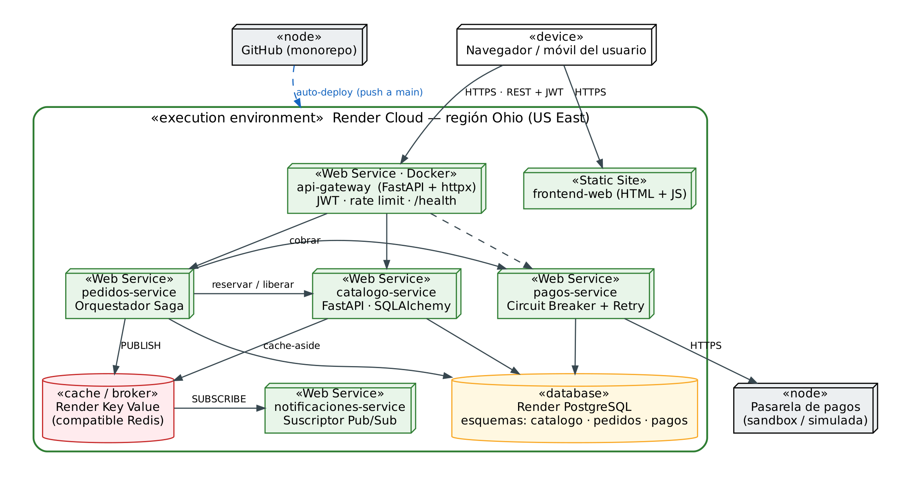

# AgroConecta 🌱

**Marketplace de productores agrícolas a comercios — arquitectura de microservicios en la nube.**

Prototipo del curso **Arquitectura de Software** (actividad ABP *Orquestando Códigos: La Sinfonía de los Sistemas*). Conecta productores del Oriente Antioqueño con restaurantes y tiendas del Valle de Aburrá y demuestra, sobre código ejecutable desplegado en **Render**, los patrones de diseño para la nube seleccionados en el informe técnico.

> 🔗 **Demo:** `https://agroconecta-web.onrender.com` · **API:** `https://agroconecta-gateway.onrender.com/docs`
> *(reemplaza con las URL reales de tu despliegue)*

---

## Arquitectura



| Servicio | Responsabilidad | Patrones |
|---|---|---|
| `api-gateway` | Punto de entrada único: autenticación JWT, roles, límite de peticiones, CORS y enrutamiento | API Gateway, Health Endpoint Monitoring |
| `catalogo-service` | Productos, fincas, categorías e inventario | Cache-Aside, Database per Service, Repository |
| `pedidos-service` | Ciclo de vida del pedido y orquestación de la transacción distribuida | Saga orquestada, Publisher |
| `pagos-service` | Cobro mediante una pasarela externa (simulada) | Circuit Breaker, Retry, Adapter |
| `notificaciones-service` | Avisos a compradores y productores ante cada evento del pedido | Subscriber |
| `frontend` | Sitio estático de demostración (HTML + JS) | — |

Infraestructura: **PostgreSQL** (un esquema por servicio) y **Render Key Value / Redis** (caché del catálogo y canal de eventos).

### Dónde está cada patrón en el código

| Patrón | Archivo |
|---|---|
| API Gateway | [`api-gateway/app/routes.py`](api-gateway/app/routes.py), [`proxy.py`](api-gateway/app/proxy.py), [`auth.py`](api-gateway/app/auth.py), [`rate_limit.py`](api-gateway/app/rate_limit.py) |
| Saga orquestada (con compensación) | [`pedidos-service/app/saga/orquestador.py`](pedidos-service/app/saga/orquestador.py) |
| Reserva atómica de inventario (sin sobreventa) | [`catalogo-service/app/repositories/productos.py`](catalogo-service/app/repositories/productos.py) → `descontar_si_hay()` |
| Cache-Aside | [`catalogo-service/app/services/catalogo.py`](catalogo-service/app/services/catalogo.py), [`cache.py`](catalogo-service/app/cache.py) |
| Circuit Breaker | [`pagos-service/app/resiliencia/circuit_breaker.py`](pagos-service/app/resiliencia/circuit_breaker.py) |
| Retry con espera exponencial | [`pagos-service/app/main.py`](pagos-service/app/main.py) → `cobrar_con_reintentos()` |
| Adapter (pasarela de pagos) | [`pagos-service/app/pasarelas/`](pagos-service/app/pasarelas/) |
| Publisher / Subscriber | [`pedidos-service/app/eventos.py`](pedidos-service/app/eventos.py) → [`notificaciones-service/app/main.py`](notificaciones-service/app/main.py) |
| Database per Service | `app/db.py` de cada servicio (variable `DB_SCHEMA`) |
| Health Endpoint Monitoring | `GET /health` en cada servicio y `GET /api/estado` en el gateway |
| Repository | [`catalogo-service/app/repositories/`](catalogo-service/app/repositories/) |

Diagramas UML: [`docs/diagramas/`](docs/diagramas/) (casos de uso, clases, secuencia y despliegue).

---

## Estructura del repositorio

```
agroconecta/
├── render.yaml                # Blueprint de Render: infraestructura como código
├── docker-compose.yml         # Entorno local completo
├── ruff.toml                  # Reglas de estilo
├── .github/workflows/ci.yml   # Lint + pruebas + build de imágenes en cada push
├── frontend/                  # index.html · app.js · styles.css · config.js
├── api-gateway/
├── catalogo-service/
├── pedidos-service/
├── pagos-service/
├── notificaciones-service/    # cada servicio: app/ · tests/ · Dockerfile · requirements.txt
├── scripts/verificar.py       # ejecuta las 6 pruebas del plan de verificación
└── docs/diagramas/
```

---

## Ejecutar en local

### Opción A — Docker (recomendada)

Requiere [Docker Desktop](https://www.docker.com/products/docker-desktop/).

```bash
docker compose up --build
```

- Frontend: <http://localhost:8080>
- API Gateway (Swagger): <http://localhost:8000/docs>
- Estado de todos los servicios: <http://localhost:8000/api/estado>

Para detener: `Ctrl + C` y luego `docker compose down` (añade `-v` para borrar la base de datos).

### Opción B — Sin Docker (Python 3.12)

Sin `DATABASE_URL` cada servicio usa **SQLite** y sin `REDIS_URL` el catálogo usa una **caché en memoria**. Todo funciona excepto las notificaciones, que requieren Redis.

Abre **5 terminales**, una por servicio. En cada una:

```bash
cd catalogo-service            # luego pedidos-service, pagos-service, notificaciones-service, api-gateway
python -m venv .venv
# Windows:      .venv\Scripts\activate
# macOS/Linux:  source .venv/bin/activate
pip install -r requirements.txt
```

y arranca con el puerto que le corresponde:

| Servicio | Comando |
|---|---|
| catalogo-service | `uvicorn app.main:app --port 8001` |
| pedidos-service | `uvicorn app.main:app --port 8002` |
| pagos-service | `uvicorn app.main:app --port 8003` |
| notificaciones-service | `uvicorn app.main:app --port 8004` |
| api-gateway | `uvicorn app.main:app --port 8000` |

Para el frontend, en una sexta terminal: `cd frontend` y `python -m http.server 8080`. Abre <http://localhost:8080>.

### Cuentas de demostración

| Rol | Correo | Contraseña |
|---|---|---|
| Comprador (restaurante) | `comprador@agroconecta.co` | `Comprador123*` |
| Productor | `productor@agroconecta.co` | `Productor123*` |
| Administrador | `admin@agroconecta.co` | `Admin123*` |

Se crean automáticamente al iniciar el gateway (desactívalo con `CREAR_USUARIOS_DEMO=false`). El catálogo arranca con 8 productos de la *Finca La Esperanza* (Marinilla).

---

## Pruebas

**Pruebas unitarias** (dentro de cada servicio, con su entorno activado):

```bash
pip install pytest httpx
pytest -q
```

**Verificación de punta a punta** con el sistema corriendo (local o en Render):

```bash
pip install httpx
python scripts/verificar.py                                         # local
python scripts/verificar.py https://agroconecta-gateway.onrender.com   # en la nube
```

Resultado esperado:

```
▶ 1. Pedido exitoso (Saga + Publisher/Subscriber)
  HTTP 201 · estado PAGADO · pasos Saga: INICIADA → STOCK_RESERVADO → PAGADO → COMPLETADA
▶ 2. Pago rechazado → compensación de la Saga
  HTTP 503 · estado CANCELADO · Inventario de fresa antes 40 · después 40
▶ 3. Falla en cascada → Circuit Breaker
  Circuito: ABIERTO (3 fallos) · Catálogo sigue respondiendo: True
▶ 4. Concurrencia: 20 pedidos simultáneos por 5 kg de mora
  PAGADOS: 5 · CANCELADOS: 15 · stock final: 0
▶ 5. Cache-Aside: 100 consultas del mismo producto
  Backend: redis · aciertos 100 · fallos 1
  7/7 pruebas superadas
```

---

## Despliegue en Render

1. Sube este repositorio a GitHub (público o privado).
2. Crea una cuenta en <https://render.com> e inicia sesión con GitHub.
3. **New → Blueprint** → elige el repositorio → Render lee `render.yaml` y muestra los 6 servicios, la base de datos y el Key Value. Pulsa **Apply**.
4. Espera a que todo quede en verde (la primera vez tarda entre 5 y 10 minutos).
5. Abre `agroconecta-web` y entra con una cuenta de demostración.

Render crea automáticamente `INTERNAL_TOKEN` y `JWT_SECRET` (grupo `agroconecta-secretos`) y conecta cada servicio con la base de datos y el Key Value. Cada *push* a `main` redespliega solo el servicio cuya carpeta cambió.

**Si el frontend o el gateway no encuentran a los demás servicios**, revisa en *Environment* del gateway que `CATALOGO_URL`, `PEDIDOS_URL`, `PAGOS_URL` y `NOTIFICACIONES_URL` tengan el dominio público de cada servicio (por ejemplo `agroconecta-catalogo.onrender.com`). Si Render asignó un nombre con sufijo, corrígelo ahí y en `pedidos-service`. Para el frontend, ajusta `API_HOST` y vuelve a desplegarlo.

### Particularidades del plan gratuito

- Los servicios **se suspenden tras 15 minutos sin tráfico** y tardan cerca de un minuto en despertar. Antes de la presentación abre `/api/estado` del gateway o ejecuta `scripts/verificar.py`, que espera a que todos respondan.
- Los Web Services gratuitos **no reciben tráfico por la red privada**, así que se llaman entre sí por su URL pública y se protegen con `INTERNAL_TOKEN` (sin ese token responden `401`). En un plan pago se convertirían en *Private Services*.
- La base de datos gratuita **vence a los 30 días** de creada, y el Key Value gratuito no persiste datos.
- Las notificaciones se guardan en memoria del servicio: se pierden si este se reinicia o se suspende.

---


## API principal (vía gateway)

| Método y ruta | Rol | Descripción |
|---|---|---|
| `POST /api/auth/registro` · `POST /api/auth/login` | público | Registro e inicio de sesión (JWT) |
| `GET /api/productos` · `GET /api/productos/{id}` | público | Catálogo (usa caché) |
| `POST /api/productos` · `PATCH /api/productos/{id}` | productor validado | Publicar o editar producto |
| `PATCH /api/productos/{id}/inventario` | productor validado | Actualizar stock |
| `POST /api/pedidos` | comprador | Crea el pedido y ejecuta la Saga |
| `GET /api/pedidos` · `GET /api/pedidos/{id}` | autenticado | Pedidos propios / recibidos / todos (admin) |
| `PATCH /api/pedidos/{id}/estado` | productor / admin | `DESPACHADO` → `ENTREGADO` |
| `GET /api/notificaciones` | autenticado | Notificaciones del usuario |
| `GET /api/admin/productores` · `PATCH .../{id}/validar` | admin | Validar productores (CU-11) |
| `GET /api/reportes/ventas` | admin | Reporte de ventas (CU-12) |
| `GET /api/pagos/estado-circuito` | público | Estado del Circuit Breaker |
| `POST /api/admin/pasarela` | admin | Ajusta la tasa de fallo simulada `{ "tasa_fallo": 0.0–1.0 }` |
| `GET /api/estado` · `GET /health` | público | Salud de todos los servicios |

Documentación interactiva completa en `/docs` del gateway.

### Variables de entorno

| Variable | Servicios | Descripción |
|---|---|---|
| `DATABASE_URL` | gateway, catálogo, pedidos, pagos | Conexión PostgreSQL (sin ella: SQLite local) |
| `DB_SCHEMA` | gateway, catálogo, pedidos, pagos | Esquema propio del servicio |
| `REDIS_URL` | catálogo, pedidos, notificaciones | Redis / Key Value (caché y eventos) |
| `INTERNAL_TOKEN` | todos | Token compartido entre servicios |
| `JWT_SECRET` | gateway | Clave de firma de los tokens |
| `CATALOGO_URL`, `PEDIDOS_URL`, `PAGOS_URL`, `NOTIFICACIONES_URL` | gateway, pedidos | URL o dominio de cada servicio |
| `PASARELA_TASA_FALLO` | pagos | Probabilidad de falla técnica simulada (0–1) |
| `CB_UMBRAL_FALLOS`, `CB_TIEMPO_RECUPERACION` | pagos | Configuración del Circuit Breaker (3 fallos, 30 s) |

---

## Convención de commits

Se usa [Conventional Commits](https://www.conventionalcommits.org/es/): `tipo(alcance): descripción`.

```
feat(pedidos): orquestador de saga con compensación
fix(catalogo): invalidar caché al actualizar precio
docs(readme): guía de despliegue en Render
test(pagos): transiciones del circuit breaker
```

Flujo: rama por funcionalidad (`feature/...`) → *pull request* revisado por otro integrante → `main` (que se despliega automáticamente).

---

## Equipo

| Integrante | Rol |
|---|---|
| [Integrante 1] | Líder y arquitecto |
| [Integrante 2] | Analista |
| [Integrante 3] | Desarrollador backend |
| [Integrante 4] | Desarrollador backend |
| [Integrante 5] | DevOps y QA |

Proyecto académico 
